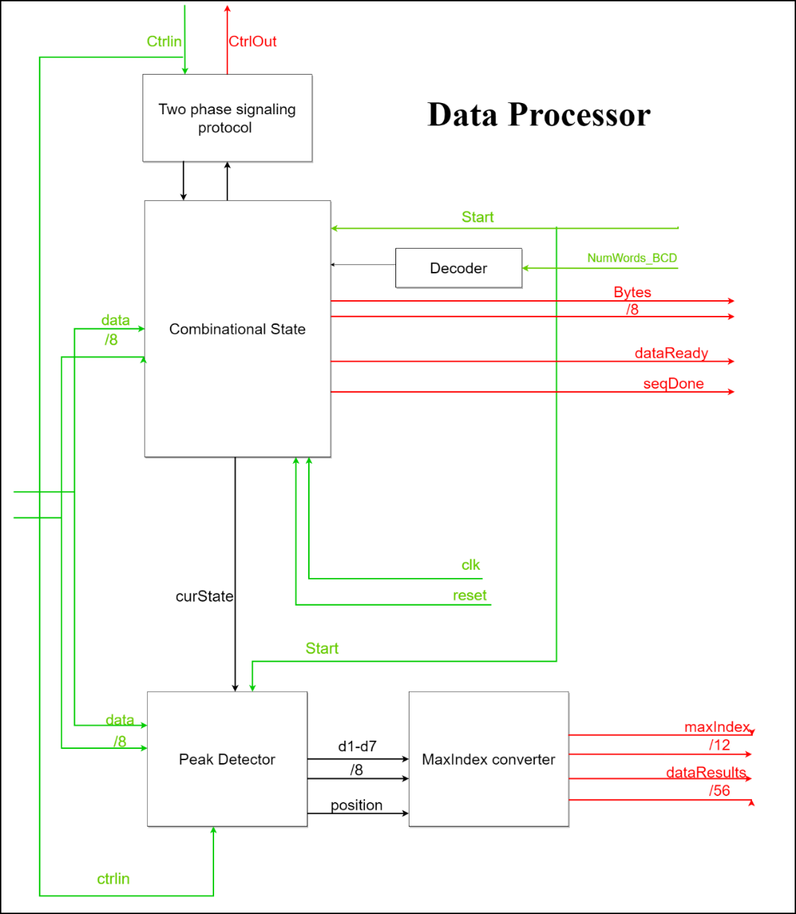
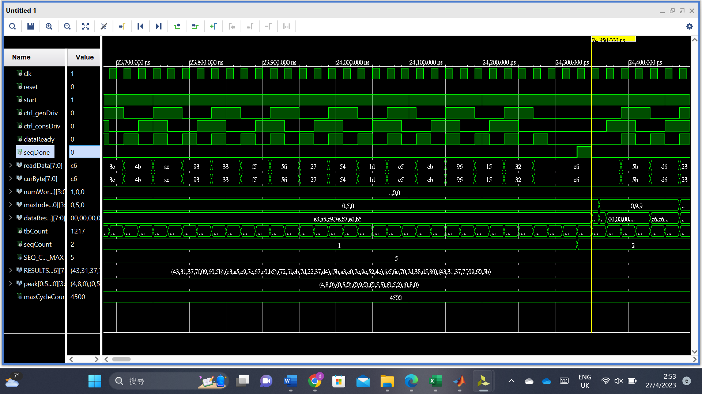
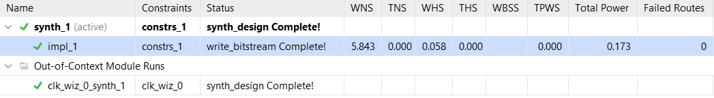

# FPGA Peak-Detection System (VHDL)

**digital-design group project | VHDL · FPGA · Vivado · UART ·**

## Overview

This five-person university project explored a UART-controlled FPGA peak-detection system. A command processor receives a request for a specified number of data samples. The data processor then requests 8-bit samples from a supplied data generator, tracks the maximum signed sample, and prepares a **seven-sample result window**: the three samples before the peak, the peak itself, and the three samples after it. The design also produces the peak's position in BCD format.

### Data-processor interface

| Signal | Purpose |
| --- | --- |
| `numWords_bcd` | Three four-bit BCD digits encoding the requested sample count (12 bits total) |
| `start` | Enables or pauses acquisition under command-processor control |
| `ctrlOut`, `ctrlIn` | Two-phase request/response signals to/from the data generator |
| `data` | Incoming 8-bit sample |
| `byte`, `dataReady` | Received sample and ready indication forwarded to the command processor |
| `dataResults` | Seven 8-bit values, with the peak at index 3 |
| `maxIndex` | Peak position encoded as three BCD digits |
| `seqDone` | Completion indication |

## My contribution

My primary assigned work was the **requested-count decoder and the associated data-processor ASM/control work**. In particular, I worked on converting the three-digit BCD input from the command processor to an integer count used by the data-acquisition controller.

For example, a BCD input of `0001 0010 0011` represents the decimal digits **1, 2, 3**. The decoding expression computes `(1 × 100) + (2 × 10) + 3 = 123` requested samples.

I also collaborated on the wider data-processor integration and debugging, including interactions among the acquisition controller, peak-detection logic, and two-phase handshaking. This was a **shared group implementation**, not a solo project.

## Key source files

Some additional files are supplied teaching/reference materials.

| File | Description |
| --- | --- |
| [`Data Processor/data_processer_test.vhd`](Data%20Processor/data_processer_test.vhd) | Combined student `dataConsume` implementation: BCD count decoding, control states, sample handling, peak logic, and results. this is **not** a testbench. |
| [`Command Processor/CommandProcessor_Final.vhd`](Command%20Processor/CommandProcessor_Final.vhd) | Command-processor implementation developed by other members of the group. |
| [`Assignment 2/peak_detector/common_pack.txt`](Assignment%202/peak_detector/common_pack.txt) | Supplied package definitions and sample sequences. |
| [`Assignment 2/peak_detector/dataGen.vhd`](Assignment%202/peak_detector/dataGen.vhd) | Supplied sample generator. |
| [`Assignment 2/peak_detector/top.vhd`](Assignment%202/peak_detector/top.vhd) | Top-level integration example. |
| [`Assignment 2/peak_detector/signed/tb_dataConsume_signed.vhd`](Assignment%202/peak_detector/signed/tb_dataConsume_signed.vhd) | Supplied data-processor testbench for signed data. |

## Verification

The team used Vivado and supplied testbench infrastructure for simulation and waveform inspection. 

## Figures for the Data Processor section

**Data-processor architecture:**

**Example simulation waveform from the coursework report:**

**Vivado implementation run status captured in the report:**

The status screenshot demonstrates that a run reported bitstream generation;

## Tools and concepts

- **Languages:** VHDL
- **environment:** AMD/Xilinx Vivado (university coursework)

